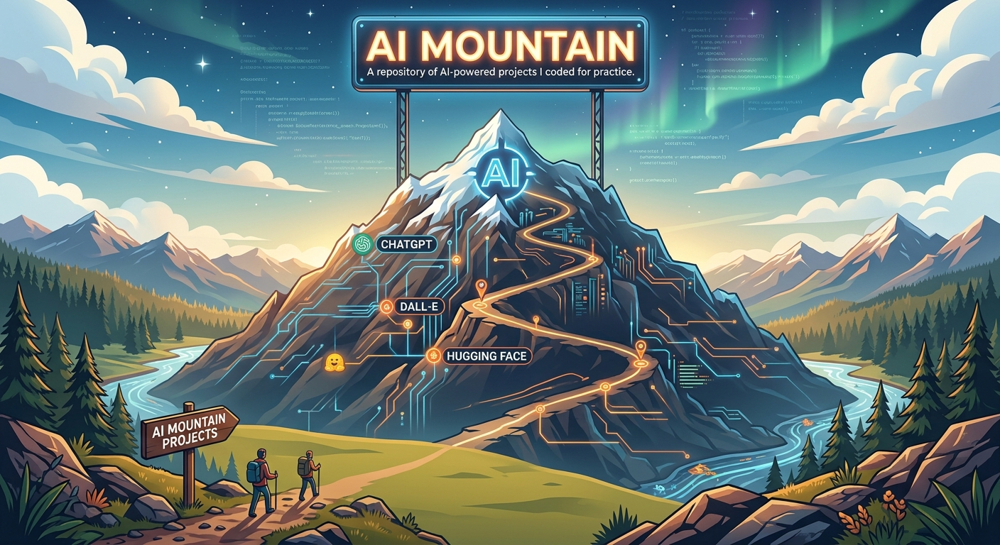

# AI Valley



AI web apps covering LLM chat, retrieval-augmented generation, agents, image generation, and in-browser computer vision. Most started from Scrimba's AI Engineer path and are being rebuilt as a suite of 7 apps that anyone can try on the [live site](https://modern-web-mountain.netlify.app/) without an API key.

This folder used to be the standalone `AI-Mountain` repo. Its full commit history (from January 2024) was merged in here.

## Try it now (no key needed)

| App | What it does | Stack |
| --- | --- | --- |
| [Lingua](./src/translator) | Translates between 20 languages, on-device in Chrome or with free cloud models, and reads results aloud | Chrome Translator + Language Detector APIs, OpenRouter free models, Web Speech API |
| [Face-Detection](./Face-Detection) | Real-time face, landmark and emotion detection from your webcam | face-api.js (TensorFlow.js) |
| [Vision AI App](./Vision%20AI%20App) | Object detection on an image, running fully in the browser | Transformers.js (`Xenova/yolos-tiny`) |

## How free AI access works

- **In-browser first.** Anything small enough runs on the visitor's device (Chrome's built-in AI, Transformers.js, face-api.js).
- **Free shared proxy.** LLM calls go to [`netlify/functions/ai-chat.mts`](../netlify/functions/ai-chat.mts), which forwards them to OpenRouter's free models with the site's key. The key never reaches the browser. The model list is fixed on the server, inputs are size-capped, and Netlify rate-limits each IP.
- **Sign in with OpenRouter.** When the shared free quota runs out, apps offer OpenRouter's OAuth (PKCE) sign-in, and calls then run on the visitor's own account (still on free models). The key is kept in that browser's `localStorage` until "Sign out". Setting a credit limit on it in OpenRouter's settings is a good idea. See [`src/shared/ai-client.ts`](./src/shared/ai-client.ts).

## Being rebuilt

| Planned app | Built from (original folders) |
| --- | --- |
| ReelRecs: movie RAG chatbot | [Movie Focus Chatbot](./Movie%20Focus%20Chatbot), [ReelRecs](./ReelRecs), [Reel Recs (Assistants API)](./Reel%20Recs%20(Open%20AI%20Assistant%20API)), [Scrimba Chatbot](./Scrimba%20Chatbot) |
| Stock report app | [AI Stock App](./AI%20Stock%20App), [Dodgy Dave Stocks (Cloudflare)](./Dodgy%20Dave%20Stocks%20(Cloudflare)) |
| Image Studio | [AI Art Generator](./AI%20Art%20Generator), [Film Fusion](./Film%20Fusion), [DALL·E Image Editor](./Dalle%20Image%20Editor), [Image Variations](./Image%20Variations), [Colorize Image AI App](./Colorize%20Image%20AI%20App) |
| Vision Lab | [Vision AI App](./Vision%20AI%20App), [Vision AI](./Vision%20AI) |
| ReAct Agent with visible reasoning | [ReAct AI Agent With Chat UI](./ReAct%20AI%20Agent%20With%20Chat%20UI) |

The originals still call OpenAI, Hugging Face or Supabase straight from the browser with keys that aren't included, so they don't run as-is.

## Course originals

Folders get removed once their replacement ships. Everything stays in git history:

- [Snapshot of all 18 originals](https://github.com/AbdulDevHub/Web-Mountain/tree/72f5b9ef51b1b83fd1eaa8ef20a93f51cdc9c879/AI%20Valley), taken right after the merge
- Replaced by Lingua: `AI Translator` (the "PollyGlot" solo project) and `Text To Speech`

## Run locally

The rebuilt apps are one multi-page Vite + TypeScript project:

```bash
cd "AI Valley"
npm install
npm run dev        # http://localhost:5173/translator/
npm run build      # type-check + build into apps/
```

`npm run dev` also serves the Netlify functions at `/api/*`. To test the free proxy locally, put a free [OpenRouter key](https://openrouter.ai/keys) in `AI Valley/.env.local`:

```bash
OPENROUTER_API_KEY=sk-or-v1-...
```

Without it, the apps fall back to "Sign in with OpenRouter", which works on localhost too.
